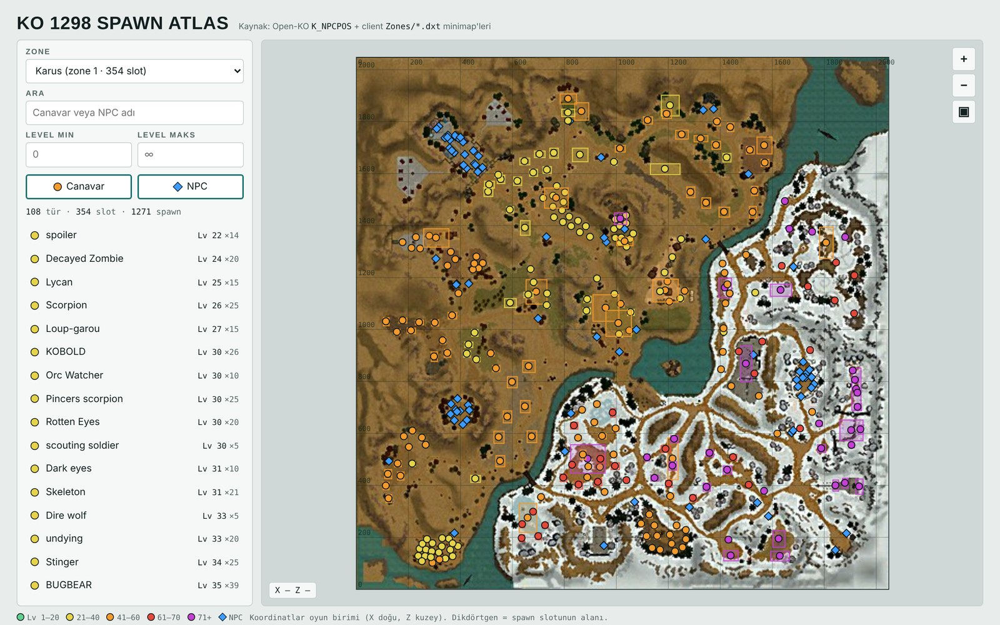
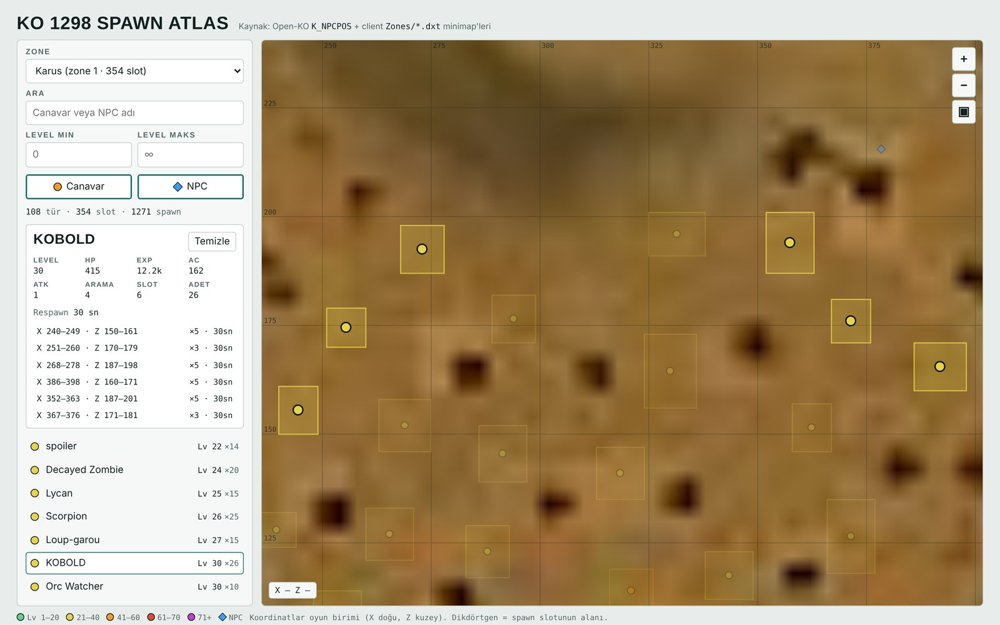
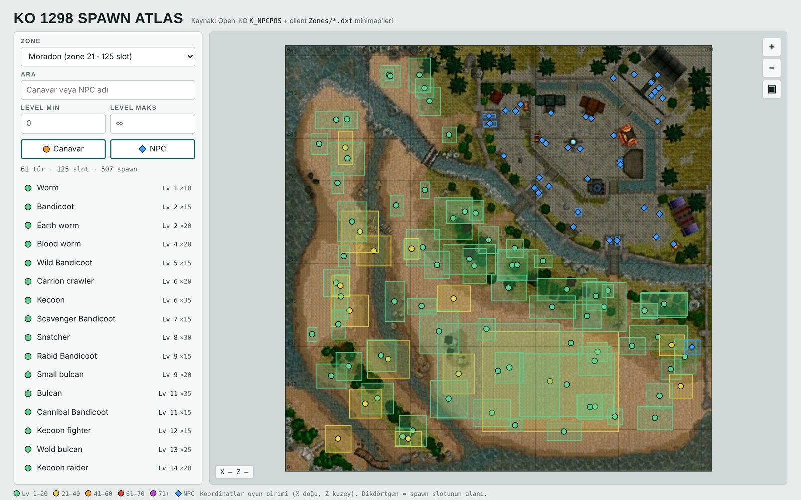
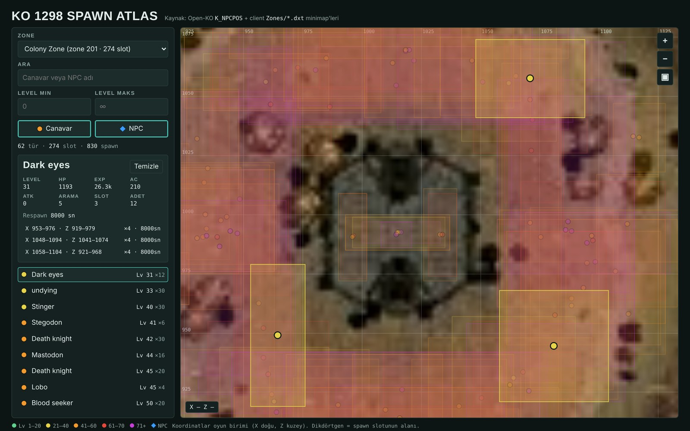

# Knight Online 1298 Spawn Atlas

An interactive map of monster and NPC spawns for the **Knight Online 1.298** era,
plotted on the original client minimaps. Pick a zone, filter by name or level, and
click any creature to see its stats and every spawn point on the map.

**▶ Live map: https://gkaragoz.github.io/knight-online-1298-map/**

Everything runs in a single self-contained HTML file — no server, no build step to
view it. The minimap images and all spawn data are embedded directly in the page.



---

## Features

### Every spawn on the real minimap

All 16 zones are drawn from the actual 1.298 client minimaps (`Zones/*.dxt`), decoded
to images and embedded in the page. Spawn points are plotted in game-world coordinates,
so a marker sits exactly where that monster spawns. Marker **color encodes level**
(green → purple), **shape encodes type** (circle = monster, diamond = NPC), and the
faint rectangle around a marker is the spawn slot's roaming area.

### Click a creature for stats and all its spawns

Selecting a monster or NPC opens a detail panel with level, HP, EXP, AC, attack,
search range, slot count and respawn time, and lists every spawn slot with its exact
coordinates. The map highlights that creature's slots and dims the rest. Click a slot
row to zoom straight to it.



### Search and filter

Filter the current zone by name, by a **level range**, or by type (monsters / NPCs).
The list and the map update together, with a running count of matching types, slots
and total spawns.


### All 16 zones

Karus, El Morad, both Eslants, Moradon, Delos, the Abyss dungeons, the Lunar War
battlegrounds, the quest zones and Colony Zone — each with its own minimap and spawn
set.



### Smooth pan & zoom, light and dark

Drag to pan, wheel or pinch to zoom, with a live coordinate readout. Rendering is
coalesced to one frame per paint and only the visible part of the minimap is drawn, so
it stays at 60 fps even on the 2048-unit zones. The page follows your system light/dark
theme.



---

## Where the data comes from

Nothing here is guessed — it is extracted directly from the open
[**Open-KO**](https://github.com/Open-KO) project, which reconstructs the 1.298 server
and ships the original client assets:

| What | Source | Table / file |
|---|---|---|
| Spawn slots (zone, coords, count, respawn) | `OpenKO-db` | `K_NPCPOS` |
| Monster stats (level, HP, EXP, AC, …) | `OpenKO-db` | `K_MONSTER` |
| NPC stats | `OpenKO-db` | `K_NPC` |
| Zone names & world size | `OpenKO-db` + server `.smd` headers | `ZONE_INFO` |
| Minimap images | `ko-client-assets` (`openko-1298` branch) | `Zones/*.dxt` |
| Zone → minimap mapping | `ko-client-assets` | `Data/Zones.tbl` |

Monster vs. NPC is resolved the same way the server does it in
`AIServer` (`ActType >= 100` → NPC table, otherwise monster table). The `.dxt` files
use the client's `NTF` texture container, which the build decodes to DXT1 and renders
to JPEG.

---

## Build it yourself

The repo ships the finished `index.html`, but you can regenerate it from the upstream
data at any time.

```bash
# clones the data repos, sets up a venv, rebuilds index.html, opens it
./build.sh
```

Or run the steps by hand:

```bash
# 1. get the data (shallow; minimaps via sparse checkout to avoid the ~1 GB client)
git clone --depth 1 https://github.com/Open-KO/OpenKO-db data/OpenKO-db
GIT_LFS_SKIP_SMUDGE=1 git clone --depth 1 --branch openko-1298 \
  --filter=blob:none --sparse https://github.com/Open-KO/ko-client-assets data/ko-client-assets
git -C data/ko-client-assets sparse-checkout set Zones

# 2. build (needs Python 3 + Pillow)
python3 build.py data/OpenKO-db/ManualSetup data/ko-client-assets/Zones
```

`build.py` parses the SQL seed files, decodes and embeds the minimaps, injects
everything into `template.html`, and writes `index.html` plus a `spawns.json` dump of
the extracted data.

```
template.html          UI + rendering (edit this, not index.html)
build.py               SQL → JSON + DXT → JPEG → index.html
tools/sqlparse.py      minimal T-SQL INSERT parser
tools/dxt2png.py       NTF/DXT1 texture decoder
index.html             generated, self-contained, = the live page
spawns.json            generated data dump
```

---

## Notes & limits

- The numbers reflect the **Open-KO reference database**. A live server may have
  retuned its spawns, so treat this as the 1.298 baseline, not a specific server's
  current state.
- Desperation Abyss and Hell Abyss have no client minimap, so they render on a plain
  grid.
- Coordinates are game units (X east, Z north); the center of a spawn slot is where the
  marker is drawn.

---

## Attribution & license

The **viewer and build tooling** are © 2026 gkaragoz and Contributors, licensed under
the **PolyForm Noncommercial License 1.0.0** with additional terms — free for personal,
hobby and educational use, **not** for commercial use without permission. See
[`LICENSE`](LICENSE). This is a source-available project, not OSI open source.

The **Knight Online game data and minimap assets are not mine and are not covered by
that license.** Knight Online and its assets belong to their respective rights holders
(© MGAME Corporation / Noah System). They are used here only for an **unofficial,
noncommercial fan tool**, sourced from the community [Open-KO](https://github.com/Open-KO)
project. This project is not affiliated with or endorsed by the owners or operators of
Knight Online. Rights holders who want content removed can open an issue.
